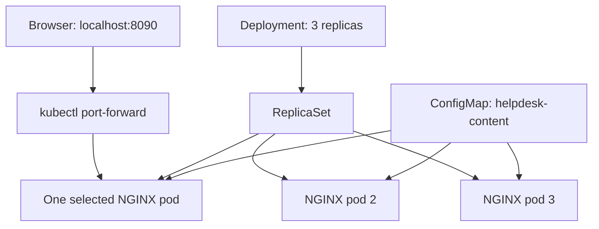

# Kubernetes Help Desk Portal with Rancher Desktop

A hands-on Kubernetes project by **Farhan Muntasir** demonstrating application deployment, ConfigMap volumes, scaling, pod replacement, and log inspection on a local cluster.

## Project Overview

Deployed a custom static IT Help Desk Portal using NGINX on Rancher Desktop. Scaled the deployment from 1 to 3 replicas, deleted a pod to test automatic replacement, and inspected HTTP access logs.

This is a local learning project. The page displays support topics; it does not submit or manage real tickets. All replicas run on one local node, so this setup does not demonstrate node-level high availability.

## Technologies

Kubernetes • Rancher Desktop • NGINX • ConfigMaps • YAML • Windows PowerShell • HTML/CSS

## Architecture



Port-forward connects to one selected pod. It does not distribute requests across all replicas. No Kubernetes Service or Ingress was created in this lab.

## Prerequisites

- Rancher Desktop running with Kubernetes enabled
- PowerShell and kubectl available
- Internet access to pull the NGINX container image
- A local `index.html` file containing the portal webpage

## 1. Verify the Cluster

```powershell
kubectl config current-context
kubectl get nodes
```

Verified context: `rancher-desktop`. The local node reported `Ready`.

## 2. Create the Workspace and Namespace

```powershell
New-Item -ItemType Directory -Force "$HOME\rancher-helpdesk-portal"
Set-Location "$HOME\rancher-helpdesk-portal"
kubectl create namespace helpdesk-lab
kubectl get namespace helpdesk-lab
```

The namespace groups this project's Kubernetes resources.

## 3. Prepare the Webpage and ConfigMap

Created `index.html` containing:

- IT Help Desk Portal title
- Farhan Muntasir author credit
- Password reset, Windows/Linux, and network support topics
- Lab version 1.0

```powershell
Get-Item .\index.html
Get-Content .\index.html -Head 5
kubectl create configmap helpdesk-content --from-file=index.html=.\index.html -n helpdesk-lab
kubectl describe configmap helpdesk-content -n helpdesk-lab
```

The ConfigMap stores the HTML as non-sensitive configuration data.

## 4. Create deployment.yaml

The final saved configuration uses 3 replicas:

```yaml
apiVersion: apps/v1
kind: Deployment
metadata:
  name: helpdesk-portal
  namespace: helpdesk-lab
spec:
  replicas: 3
  selector:
    matchLabels:
      app: helpdesk-portal
  template:
    metadata:
      labels:
        app: helpdesk-portal
    spec:
      containers:
        - name: nginx
          image: nginx:stable-alpine
          ports:
            - containerPort: 80
          volumeMounts:
            - name: website
              mountPath: /usr/share/nginx/html
              readOnly: true
      volumes:
        - name: website
          configMap:
            name: helpdesk-content
```

The lab initially deployed 1 replica and then scaled to 3. The ConfigMap volume supplies `index.html` at NGINX's document root.

```powershell
kubectl apply -f .\deployment.yaml
kubectl rollout status deployment/helpdesk-portal -n helpdesk-lab --timeout=120s
kubectl get pods -n helpdesk-lab
```

## 5. Access the Portal

```powershell
kubectl port-forward deployment/helpdesk-portal 8090:80 -n helpdesk-lab
```

Keep this terminal running and visit **http://localhost:8090**.

Use a second PowerShell tab for other commands. Ctrl+C stops port-forward without deleting the deployment.

## 6. Scale the Deployment

```powershell
kubectl scale deployment/helpdesk-portal --replicas=3 -n helpdesk-lab
kubectl rollout status deployment/helpdesk-portal -n helpdesk-lab --timeout=120s
kubectl get pods -n helpdesk-lab
```

Verified 3 pods with `1/1` Ready and `Running` status. Updated the saved YAML from `replicas: 1` to `replicas: 3` so a later apply preserves the desired count.

## 7. Verify Pod Replacement

List pods and choose one of this lab's pod names:

```powershell
kubectl get pods -n helpdesk-lab
```

Replace `POD_NAME` below with the selected name:

```powershell
kubectl delete pod POD_NAME -n helpdesk-lab
kubectl get pods -n helpdesk-lab -w
```

A new pod with a different name appeared and reached `1/1 Running`, restoring 3 replicas. Press Ctrl+C to stop watching.

If the deleted pod was the one selected by port-forward, restart port-forward to connect to an available pod.

## 8. Inspect Logs

```powershell
kubectl logs -l app=helpdesk-portal -n helpdesk-lab --tail=20 --prefix=true
```

Refresh the portal to generate requests.

| Observed result | Meaning |
|---|---|
| `GET /` with `200` | Page served successfully |
| `GET /` with `304` | Browser's cached copy was still valid |
| `GET /favicon.ico` with `404` | Optional tab icon was absent |

## Troubleshooting

### Default NGINX page appeared on port 8080

The browser initially showed the default page. Restarted port-forward on local port 8090 and verified the custom portal appeared. The exact cause of the original response was not established.

To inspect the content inside the container:

```powershell
kubectl exec deployment/helpdesk-portal -n helpdesk-lab -- cat /usr/share/nginx/html/index.html
```

### Commands cannot be entered while port-forward runs

Open another PowerShell tab. The forwarding command occupies its terminal until stopped.

### Missing favicon

The `404` concerned `/favicon.ico`, not the portal's main page. Adding an icon can remove this request error.

## Verified Results

| Validation | Result |
|---|---|
| Rancher Desktop context and Ready node | Passed |
| Namespace and HTML ConfigMap created | Passed |
| NGINX deployment rolled out | Passed |
| Custom page accessible on localhost:8090 | Passed |
| Scaled from 1 to 3 replicas | Passed |
| Deleted pod automatically replaced | Passed |
| HTTP 200 and 304 observed in logs | Passed |
| Saved YAML updated to 3 replicas | Passed |

## Resume Bullet

- Deployed a custom NGINX portal on a local Kubernetes cluster using Rancher Desktop and a ConfigMap volume; scaled from 1 to 3 replicas, verified automatic pod replacement, and analyzed HTTP access logs to validate application delivery.

## Interview Questions and Answers

### 1. What did you build?

I deployed a static help desk portal using NGINX on Rancher Desktop's Kubernetes cluster. I mounted HTML through a ConfigMap, scaled to 3 pods, tested replacement after deleting a pod, and verified requests in the logs.

### 2. What is a pod?

A pod is Kubernetes' smallest deployable unit. It contains one or more containers sharing networking and storage resources. Each pod in this project ran one NGINX container.

### 3. Why use a Deployment instead of creating a standalone pod?

A Deployment manages pod templates and rollout changes through ReplicaSets. Its ReplicaSet maintains the desired number of pods, which enabled the replacement test.

### 4. What happened when you deleted a pod?

The ReplicaSet detected fewer pods than the desired count of 3 and created a replacement. The replacement had a new name and reached Running status.

### 5. Was the deleted pod restarted?

No. Kubernetes created a replacement pod. This differs from restarting a container inside an existing pod.

### 6. What is a ConfigMap?

A ConfigMap stores non-sensitive configuration data. I used one to provide the webpage without building a custom container image.

### 7. Where was the ConfigMap mounted?

At `/usr/share/nginx/html`, NGINX's document root. The `index.html` key became a file in that directory.

### 8. What does 8090:80 mean?

Local port 8090 forwards to port 80 in the selected pod. The browser connects to localhost:8090 while NGINX listens on port 80.

### 9. Does port-forward balance requests across 3 pods?

No. It selects one pod for the forwarding session. A Service can provide a stable internal endpoint for traffic to matching pods; that was not implemented in this lab.

### 10. Why use a namespace?

It scopes and groups related Kubernetes resources. I used `helpdesk-lab` to separate the portal resources from other projects.

### 11. How did you inspect logs from multiple pods?

I used `kubectl logs` with the `app=helpdesk-portal` label selector and `--prefix=true` to identify the pod and container for each log line.

### 12. What do HTTP 200, 304, and 404 mean here?

200 indicates a successful page response. 304 means the cached representation remains valid. 404 means the requested resource was absent; in this project it was the favicon.

### 13. Why update the replica count in the YAML after scaling?

The scale command changed the live deployment. Updating the manifest kept the saved desired state consistent and prevented a future apply of the old file from returning the count to 1.

### 14. How would you troubleshoot a pod that fails to start?

I would inspect `kubectl get pods`, `kubectl describe pod POD_NAME -n helpdesk-lab`, logs, and namespace events. I would check image pulls, volume references, and container errors. This lab's pods started successfully.

### 15. What are the limits of this project?

It runs on a single local node, serves static content, and uses temporary port-forward access. It does not demonstrate production datacenter experience, node failure tolerance, real ticket processing, or production monitoring.

### 16. What would you improve next?

Add a Service, readiness/liveness probes, resource requests and limits, a pinned image version, and a documented update process. These are proposed next steps, not completed features.

## Screenshots to Add

Create a `screenshots` folder and upload your actual screenshots. Suggested files:

- `portal.png`
- `three-pods.png`
- `pod-replacement.png`
- `http-logs.png`
- `saved-replicas.png`

After uploading, embed them using relative Markdown paths, for example:

```markdown

```

## Optional Cleanup

This deletes every resource in this lab namespace:

```powershell
kubectl delete namespace helpdesk-lab
```

## Author

**Farhan Muntasir** • [GitHub: farhan115](https://github.com/farhan115)
