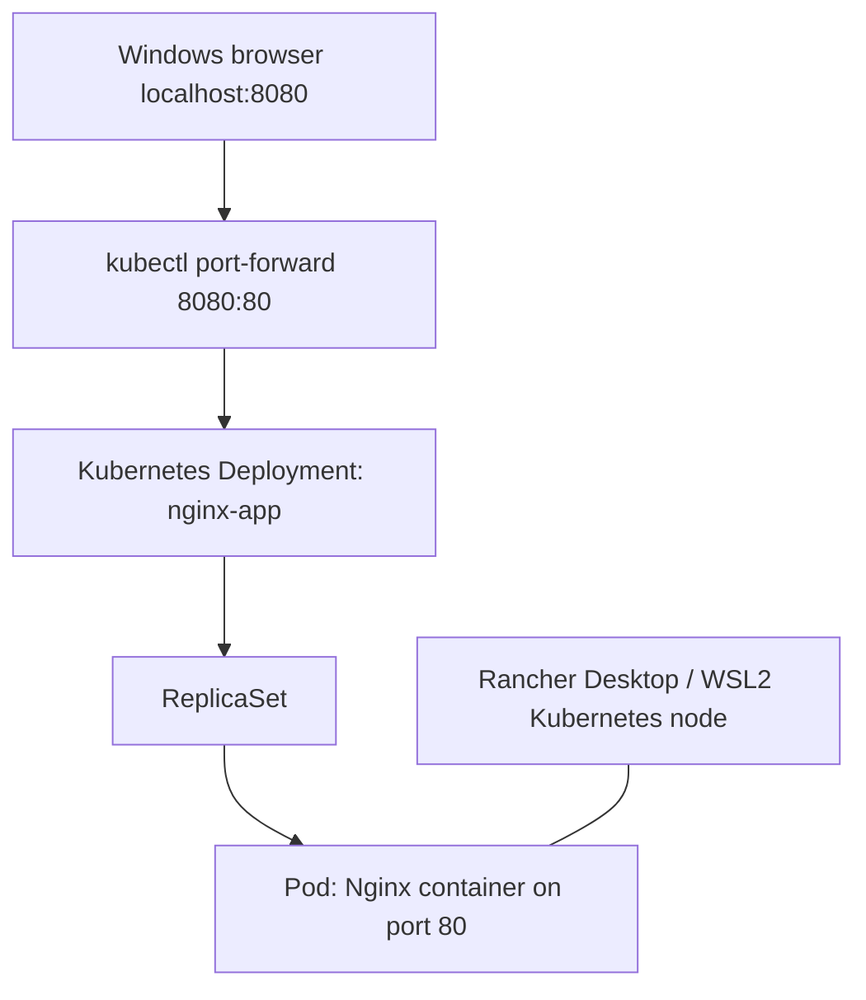

# Day 01 — Deploying and Troubleshooting Nginx on Kubernetes

## Objective
Provision a local Kubernetes environment using Rancher Desktop, deploy an Nginx web server, inspect its Pod and logs, and access the application from a Windows browser.

**Result:** Completed. Nginx displayed its welcome page at `http://localhost:8080`.

## Environment
- Windows and PowerShell
- WSL2 with Rancher Desktop
- Kubernetes `v1.37.2+k3s1` (as reported by `kubectl get nodes`)
- `containerd` runtime
- Nginx image `nginx:stable`

## Architecture



Port forwarding is a development/testing mechanism; it is not a production ingress configuration.

## Commands and explanation

### 1. Verify the cluster
```powershell
kubectl get nodes
```
Observed: one control-plane node (`desktop-4mjf3t3`) in `Ready` state.

### 2. Create the Deployment
```powershell
kubectl create deployment nginx-app --image=nginx:stable
```
A Deployment declares the desired application state and manages ReplicaSets and Pods. Observed output: `deployment.apps/nginx-app created`.

### 3. Inspect Pod health
```powershell
kubectl get pods
```
Observed: one Pod, `1/1` ready, `Running`, `0` restarts. Pod names are generated and may change.

### 4. Inspect detailed status
```powershell
kubectl describe pod nginx-app-77fc5d4f-l2nl2
```
Observed: Pod IP `10.42.0.10`, image `nginx:stable`, runtime `containerd`, `Ready: True`, `Restart Count: 0`. Replace the example Pod name with the current name shown by `kubectl get pods`.

### 5. Check application logs
```powershell
kubectl logs deployment/nginx-app
```
Observed Nginx startup and worker-process messages with no startup errors visible. Logs are useful for investigating failed initialization, application errors, and runtime behavior.

### 6. Access Nginx locally
```powershell
kubectl port-forward deployment/nginx-app 8080:80
```
Open `http://localhost:8080` in a browser while the command is running. Observed: **Welcome to nginx!**. The first port is the local Windows port; the second is the target container port. Stop forwarding with `Ctrl+C`.

## Evidence screenshots
Add your actual screenshots to the `screenshots/` directory with these names:

| Screenshot | Evidence |
| --- | --- |
| `01-cluster-ready.png` | `kubectl get nodes` — node Ready |
| `02-deployment-created.png` | Successful Deployment creation |
| `03-pod-running.png` | `kubectl get pods` — 1/1 Running |
| `04-pod-details.png` | `kubectl describe pod` output |
| `05-nginx-logs.png` | Nginx initialization logs |
| `06-nginx-browser.png` | Browser showing Nginx welcome page |

After uploading screenshots, embed one in this README with:

```markdown

```

## Troubleshooting reference

| Symptom | Check | Possible next step |
| --- | --- | --- |
| `kubectl` not found | `kubectl version --client` | Confirm Rancher Desktop CLI tools are installed and restart terminal |
| Node not Ready | `kubectl get nodes` | Check Rancher Desktop Kubernetes startup and WSL2 |
| Pod Pending / ContainerCreating | `kubectl describe pod <pod-name>` | Review Events and allow image pull to complete |
| ImagePullBackOff | `kubectl describe pod <pod-name>` | Check image name and network connectivity |
| Pod CrashLoopBackOff | `kubectl logs <pod-name> --previous` | Review crash logs and configuration |
| Local port 8080 busy | `kubectl port-forward deployment/nginx-app 8081:80` | Visit `http://localhost:8081` instead |

## Interview questions

**What is a Pod?** The smallest deployable unit in Kubernetes; it hosts one or more tightly coupled containers.

**What is a Deployment?** A controller that manages ReplicaSets and helps maintain the desired number of application Pods.

**What does `1/1 Running` mean?** One of one containers is ready, and the Pod is in the Running phase.

**Why use `kubectl describe`?** To inspect configuration, conditions, container state, and recent events when diagnosing problems.

**What is port forwarding?** A temporary local tunnel to a Pod or workload that allows development/testing access without exposing a public service.

**How do you investigate a failing Pod?** Check `kubectl get pods`, `kubectl describe pod`, and `kubectl logs`, then use events and health information to isolate the issue.

## Cleanup (optional)
```powershell
kubectl delete deployment nginx-app
```
Do not run cleanup if you want to reuse the Deployment in Day 2.

## Next lab
Day 02: Scale Nginx replicas, inspect the ReplicaSet, delete a Pod, and observe Kubernetes self-healing.
