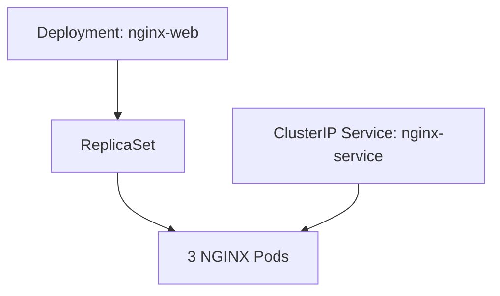

# Kubernetes Lab: NGINX Deployment, Scaling & Troubleshooting

**Author:** Farhan Muntasir  
**GitHub:** [farhan115](https://github.com/farhan115)  
**Environment:** Rancher Desktop on Windows, PowerShell, single-node Kubernetes  
**Completed:** November 16, 2026

## Overview

Deployed NGINX in a dedicated namespace, exposed it through a ClusterIP Service, accessed it using port forwarding, scaled to three replicas, tested automatic Pod replacement, intentionally introduced an invalid image tag, and recovered with a Deployment rollback.

This project demonstrates application lifecycle management and evidence-based troubleshooting on a local cluster.

## Verified results

| Test | Observed result |
|---|---|
| Cluster context | `rancher-desktop` |
| Node | `desktop-4mjf3t3`, Ready |
| Namespace | `nginx-lab` |
| Deployment | `nginx-web` |
| Working image | `nginx:stable` |
| Service | `nginx-service`, ClusterIP, port 80 |
| Local application access | NGINX welcome page at `http://localhost:8080` |
| Scaling | Increased from 1 to 3 ready replicas |
| Replacement test | Pod ending `jbwf4` deleted; new Pod ending `rz7hs` created |
| Replacement Pod IP | `10.42.0.49` |
| Intentional failure | Invalid tag produced `ErrImagePull` and `ImagePullBackOff` |
| Recovery | Rollback completed; image restored to `nginx:stable` |
| Final Deployment | 3 ready, 3 up-to-date, 3 available |
| Final Pods | 3 Running, each with 0 restarts |
| Final Service endpoint addresses | `10.42.0.46`, `10.42.0.47`, `10.42.0.49` |

Names and addresses above are evidence from this run. Kubernetes generates Pod names and IPs, so a fresh run will differ.

## Prerequisites

- Rancher Desktop running with Kubernetes enabled.
- `kubectl` available in PowerShell.
- Network access to download the NGINX image.
- Local port 8080 available, or another unused port.

Run the numbered steps in order. Copy commands from PowerShell code blocks; example output is not a command. Creation commands assume the lab resources do not already exist.

## Architecture and resource responsibilities



The Deployment manages rollout history and the desired Pod template. Its ReplicaSet maintains the desired number of Pods. The Service selects Pods using labels and provides an internal access point. EndpointSlices track the selected backend addresses.

For browser access, `kubectl port-forward` forwards local port 8080 through the Kubernetes API to one selected backend Pod on port 80. This is a development access method; it does not demonstrate Service traffic balancing across all replicas.

## 1. Verify the cluster

```powershell
kubectl config get-contexts
kubectl config current-context
kubectl config use-context rancher-desktop
kubectl cluster-info
kubectl get nodes -o wide
```

**Explanation:** A context selects a cluster and credentials, optionally with a default namespace. Confirming it prevents commands from targeting an unintended cluster. `cluster-info` checks access to cluster services, while `get nodes` shows node readiness.

**Observed:** The Rancher Desktop context was selected, the API was reachable, and the single node was Ready.

## 2. Create the namespace and Deployment

```powershell
kubectl create namespace nginx-lab
kubectl create deployment nginx-web --image=nginx:stable -n nginx-lab
kubectl rollout status deployment/nginx-web -n nginx-lab --timeout=120s
kubectl get deployments,pods -n nginx-lab -o wide
```

**Explanation:** The namespace groups lab resources. The Deployment initially requests one replica. Kubernetes schedules a Pod, pulls the image if necessary, and starts NGINX. The rollout command waits for the Deployment to finish becoming available.

**Expected:** Deployment readiness `1/1`; one Pod with `1/1` Ready and status Running.

The image tag `stable` is mutable. This lab did not record an image digest, so a later run may download a different NGINX build. Pin a digest when exact image reproducibility is required.

## 3. Create a Service and access the application

```powershell
kubectl expose deployment nginx-web --name=nginx-service --port=80 --target-port=80 --type=ClusterIP -n nginx-lab
kubectl get services -n nginx-lab
kubectl port-forward service/nginx-service 8080:80 -n nginx-lab
```

Keep this terminal open while using the application. Open **http://localhost:8080** in the browser.

| Setting | Meaning |
|---|---|
| `ClusterIP` | Internal cluster Service |
| `--port=80` | Service listening port |
| `--target-port=80` | Application port in the selected Pod |
| `8080:80` | Local port 8080 forwarded to Service port 80 |

**Observed:** The browser displayed “Welcome to nginx!” and the terminal reported connections on port 8080.

Use a second PowerShell tab for the remaining commands.

## 4. Scale to three replicas

```powershell
kubectl scale deployment nginx-web --replicas=3 -n nginx-lab
kubectl rollout status deployment/nginx-web -n nginx-lab --timeout=120s
kubectl get deployment nginx-web -n nginx-lab
kubectl get pods -n nginx-lab -o wide
kubectl get endpointslices -n nginx-lab -l kubernetes.io/service-name=nginx-service
```

**Explanation:** Scaling changes the desired replica count. The ReplicaSet creates two additional Pods. The Service selector continues selecting matching Pods as they become ready.

**Observed:** The Deployment reached 3/3 ready. The Service initially listed Pod addresses `10.42.0.46`, `10.42.0.47`, and `10.42.0.48`.

All replicas ran on one local node. This demonstrates replication but does not provide resilience against that node failing. No application-specific readiness or liveness probes were configured in this exercise.

## 5. Test automatic Pod replacement

```powershell
kubectl get pods -n nginx-lab -o custom-columns=NAME:.metadata.name,UID:.metadata.uid

$podToDelete = kubectl get pods -n nginx-lab -l app=nginx-web -o jsonpath='{.items[0].metadata.name}'
$podToDelete
kubectl delete pod $podToDelete -n nginx-lab
kubectl get pods -n nginx-lab -w
```

When three Pods are Running and ready, press **Ctrl+C** to stop watching, then run:

```powershell
kubectl get deployment nginx-web -n nginx-lab
kubectl get pods -n nginx-lab -o wide
```

**Explanation:** Deleting a Pod does not reduce the desired replica count. The ReplicaSet detects that a replica is missing and creates a new Pod. It has a new identity, rather than being a restart of the deleted Pod.

**Observed:** The Pod ending `jbwf4` was replaced by a Pod ending `rz7hs`, with IP `10.42.0.49`. The Deployment returned to 3/3 ready.

If the port-forward process was attached to the deleted Pod, rerun the forwarding command in the first tab. Port forwarding does not automatically switch its existing connection to another Pod.

## 6. Introduce and diagnose an image failure

This step intentionally changes only the lab Deployment to use a nonexistent image tag.

```powershell
kubectl set image deployment/nginx-web nginx=nginx:lab-invalid-tag-12345 -n nginx-lab
kubectl get pods -n nginx-lab -w
```

Wait for `ErrImagePull` or `ImagePullBackOff`, press **Ctrl+C**, and investigate:

```powershell
kubectl get events -n nginx-lab --sort-by=.metadata.creationTimestamp
kubectl get deployment nginx-web -n nginx-lab
```

For a closer inspection, run `kubectl get pods -n nginx-lab`, copy the failing Pod name, and use `kubectl describe pod POD_NAME -n nginx-lab`, replacing `POD_NAME` with that name.

**Observed diagnosis:** Events reported that `docker.io/library/nginx:lab-invalid-tag-12345` was not found. The new Pod could not pull its image and entered backoff.

**Observed Deployment:** 3 ready, 1 up-to-date, 3 available. Up-to-date counts Pods matching the new template, even when they are not ready. The default rolling update retained the three old healthy Pods while the new Pod failed to start. A fourth Pod existed temporarily during this rollout.

## 7. Roll back and verify recovery

```powershell
kubectl rollout undo deployment/nginx-web -n nginx-lab
kubectl rollout status deployment/nginx-web -n nginx-lab --timeout=120s
kubectl get deployment nginx-web -n nginx-lab -o jsonpath='{.spec.template.spec.containers[0].image}'
kubectl get deployments,pods -n nginx-lab
kubectl get endpointslices -n nginx-lab -l kubernetes.io/service-name=nginx-service
```

**Explanation:** Rollback restores the previous Pod template from Deployment history. In this run, that restored the working `nginx:stable` image. It does not restore application data or an entire cluster.

**Observed:** The rollout completed, the failed Pod was removed, and all three healthy Pods remained available. Endpoint addresses were `.46`, `.47`, and `.49`. The NGINX welcome page loaded again in the browser.

If needed, restart forwarding:

```powershell
kubectl port-forward service/nginx-service 8080:80 -n nginx-lab
```

## Explanation questions and answers

### 1. What is Kubernetes doing in this lab?

It schedules containerized workloads and reconciles their actual state with the desired configuration. It also manages application updates and selected network endpoints.

### 2. What is a Pod?

A Pod is Kubernetes' smallest deployable unit. It contains one or more containers sharing networking and certain storage resources. Each NGINX Pod in this lab contained one container.

### 3. How do Deployment and ReplicaSet responsibilities differ?

The Deployment manages Pod-template updates and rollout history. A ReplicaSet maintains the replica count for a particular Pod template.

### 4. Why create a namespace?

It groups and scopes namespaced resources for the lab. Namespaces alone do not enforce network isolation; that requires additional controls such as applicable NetworkPolicies.

### 5. Why use a Service when Pods already have IP addresses?

Pods can be replaced and receive new addresses. A Service provides a consistent access point and selects its backend Pods through labels.

### 6. What are EndpointSlices?

They represent backend endpoints associated with a Service, including addresses, ports, and readiness-related conditions. Their updates reflected the replacement Pod's new address.

### 7. What does `-n nginx-lab` mean?

It selects the namespace for that command. Omitting it may query or modify resources in a different namespace.

### 8. What does `1/1` mean in a Pod's READY column?

One of one counted containers is ready. In this lab no application-specific readiness probe was added, so this was not a custom HTTP health check.

### 9. What is the difference between scaling and restarting?

Scaling changes the desired replica count. Restarting replaces or restarts workload instances without necessarily changing that count.

### 10. Did Pod deletion increase the restart counter?

The replacement was a new Pod, whose container started with a restart count of zero. Replacement and an in-place container restart are different events.

### 11. Why did the application remain available during the invalid image update?

The rolling update did not remove the existing healthy replicas while the new image could not become ready. The screenshots showed three available replicas throughout the failed rollout observation.

### 12. Why was UP-TO-DATE 1 while READY was 3?

One Pod matched the new, invalid-image template, but it was not ready. Three Pods from the previous working template were still ready.

### 13. What does `ImagePullBackOff` mean?

Kubernetes failed to pull an image and is delaying retries. The underlying cause must be read from events; an invalid tag was the cause here.

### 14. Does `rollout undo` undo scaling?

Deployment rollback restores an earlier Pod template, not the entire resource configuration. This rollback restored the image and left the desired replica count at three.

### 15. Does port forwarding expose the app publicly?

The command used here listens on local loopback addresses by default. It provides local access while the forwarding process runs, not a public production endpoint.

### 16. Does refreshing the forwarded page test load balancing across all Pods?

No. Service-based port forwarding selects a backend Pod. It does not prove that normal Service traffic is balanced across every replica.

## Troubleshooting questions and answers

### 1. Why did `--timeout-120s` produce an unknown-flag error?

It used a hyphen where an equals sign was required. Use:

```powershell
kubectl rollout status deployment/nginx-web -n nginx-lab --timeout=120s
```

This typing error occurred during the lab; the Deployment itself was healthy.

### 2. Why did PowerShell say `deployment` was not recognized?

The sample output `deployment "nginx-web" successfully rolled out` was entered as a command. It is output from `kubectl rollout status`; only type the actual kubectl command.

### 3. What if kubectl says no resources were found?

Check the context and namespace:

```powershell
kubectl config current-context
kubectl get deployments,pods,services -n nginx-lab
```

Empty output can mean the resources are in another namespace or were never created.

### 4. What if resource creation returns AlreadyExists?

Inspect the existing resource rather than repeatedly creating it:

```powershell
kubectl get deployment nginx-web -n nginx-lab
kubectl get service nginx-service -n nginx-lab
```

Continue with the existing lab resource if its configuration is correct. Do not delete an entire namespace merely to hide a creation error.

### 5. What if the browser cannot connect to localhost:8080?

Check that the forwarding process is still running and that the browser uses HTTP and the correct port. Verify the Service and ready Pods. If forwarding ended, restart it:

```powershell
kubectl get services,pods -n nginx-lab
kubectl port-forward service/nginx-service 8080:80 -n nginx-lab
```

### 6. What if port 8080 is already occupied?

Use an unused local port:

```powershell
kubectl port-forward service/nginx-service 8081:80 -n nginx-lab
```

Then open `http://localhost:8081`.

### 7. Why did forwarding stop after deleting a Pod?

The session may have selected that Pod. Start a new forwarding session; the Service name lets kubectl select a current backend, but an existing session does not automatically reconnect after its Pod disappears.

### 8. How do I identify the cause of an image-pull failure?

Inspect the failing Pod's events with `kubectl describe pod POD_NAME -n nginx-lab`, substituting its actual name. Also read namespace events. Common causes include nonexistent tags, registry authentication failures, and connectivity problems. In this run the registry reported the tag was not found.

### 9. Would deleting the failing Pod fix an invalid image tag?

No. Its replacement would use the same invalid template. Correct the image or roll back the Deployment.

### 10. Why might logs be unavailable for ImagePullBackOff?

The application container has not started, so it has no application logs. Pod descriptions and events provide the useful evidence for image-pull failures.

### 11. What if rollout status times out?

A timeout means the wait ended before success; it does not undo the update. Inspect Pods and events:

```powershell
kubectl get pods -n nginx-lab -o wide
kubectl describe deployment nginx-web -n nginx-lab
kubectl get events -n nginx-lab --sort-by=.metadata.creationTimestamp
```

### 12. What if a Pod remains Pending?

Inspect its description for scheduling events. Possible causes include insufficient resources, scheduling constraints, or storage dependencies. Pending is not the same diagnosis as an image-pull backoff; use the event message to distinguish the cause.

### 13. What if a Pod shows CrashLoopBackOff?

Its container has started and repeatedly exited. Inspect the Pod, current logs, and previous container logs:

```powershell
kubectl logs POD_NAME -n nginx-lab
kubectl logs POD_NAME -n nginx-lab --previous
kubectl describe pod POD_NAME -n nginx-lab
```

Replace `POD_NAME` with the actual name. Previous logs exist only when a previous terminated container instance is available. CrashLoopBackOff was not the failure reproduced in this lab.

### 14. What if the Service has no usable endpoints?

Compare its selector with Pod labels and inspect Pod readiness:

```powershell
kubectl describe service nginx-service -n nginx-lab
kubectl get pods -n nginx-lab --show-labels
kubectl get endpointslices -n nginx-lab -l kubernetes.io/service-name=nginx-service
```

A selector mismatch or no ready matching Pods can prevent routing.

### 15. What if rollback restores the wrong image?

Inspect rollout history and the current template before making another change:

```powershell
kubectl rollout history deployment/nginx-web -n nginx-lab
kubectl get deployment nginx-web -n nginx-lab -o jsonpath='{.spec.template.spec.containers[0].image}'
```

`rollout undo` normally selects the previous revision. If history differs from this exercise, deliberately choose a verified revision or set the known intended image. Do not assume rollback history is identical across runs.

### 16. Why might old warning events remain after successful recovery?

Events describe past activity and can outlive the failed Pod. Verify the current template, rollout result, ready replicas, and application response rather than treating every historical warning as an active failure.

## Evidence to include on GitHub

Keep screenshots under an `images` directory and add Markdown links after uploading them. Useful captures are:

- Ready Rancher Desktop node.
- Initial deployment and browser welcome page.
- Three replicas and Service endpoints.
- Deleted Pod and replacement Pod.
- Invalid-image events.
- Successful rollback, final endpoints, and working browser page.

Screenshots were reviewed during the lab; image files are not bundled with this README.

## Optional cleanup

Stop port forwarding with **Ctrl+C**. This does not delete cluster resources.

When finished with the entire lab and after saving evidence, this command deletes the lab namespace and all namespaced resources inside it:

```powershell
kubectl delete namespace nginx-lab
```

Cleanup was not performed in the verified screenshots.

## References

- [Kubernetes Basics](https://kubernetes.io/docs/tutorials/kubernetes-basics/)
- [Deployments](https://kubernetes.io/docs/concepts/workloads/controllers/deployment/)
- [Services](https://kubernetes.io/docs/concepts/services-networking/service/)
- [Port forwarding](https://kubernetes.io/docs/tasks/access-application-cluster/port-forward-access-application-cluster/)
- [Images and ImagePullBackOff](https://kubernetes.io/docs/concepts/containers/images/)

## Portfolio summary

Deployed NGINX on a local Rancher Desktop Kubernetes cluster, scaled from one to three replicas, verified automatic Pod replacement and endpoint updates, diagnosed an invalid image tag through events, and restored a healthy application with Deployment rollback.
