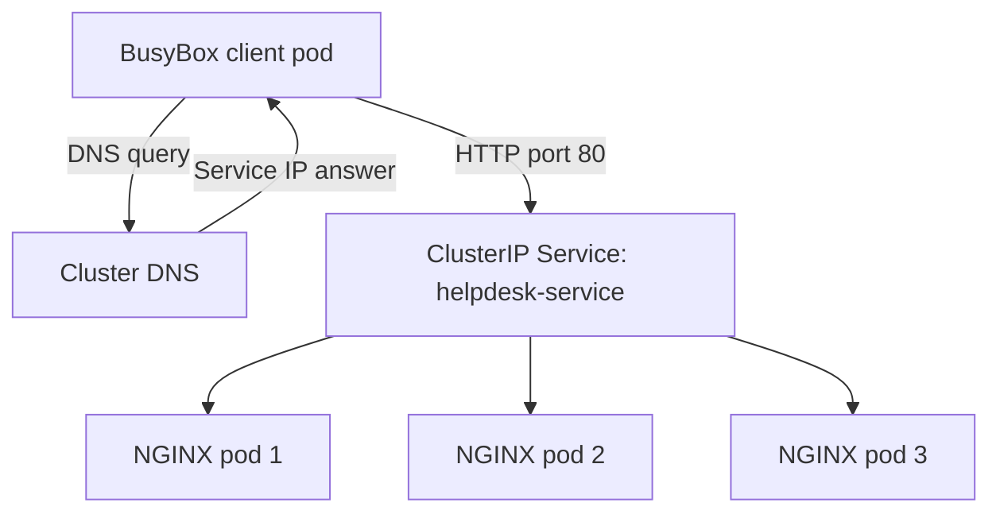

# Kubernetes Services, DNS, and Troubleshooting on Rancher Desktop

**Author:** [Farhan Muntasir](https://github.com/farhan115)  
**Environment:** Rancher Desktop, local Kubernetes cluster, Windows PowerShell  
**Project status:** Completed and verified through terminal screenshots

## Project overview

Extended an existing NGINX Help Desk Portal deployment by creating a ClusterIP Service for 3 application pods. Verified internal DNS and HTTP connectivity from a BusyBox client pod, deliberately introduced a Service selector mismatch, diagnosed missing backend addresses, and restored access. Saved and applied the Service configuration as YAML.

The portal serves static support information; it does not process real help desk tickets. This is a local lab with all 3 application pods on one node, not a production or multi-node availability deployment.

## Skills demonstrated

- Kubernetes Services and label selectors
- Internal DNS and namespace-scoped discovery
- EndpointSlice inspection and pod networking
- HTTP testing from a client pod
- Controlled failure, diagnosis, and recovery
- Declarative configuration with YAML and kubectl apply
- Windows PowerShell troubleshooting

## Architecture



The diagram shows eligible backends. This lab verified connectivity through the Service; it did not measure traffic distribution across individual pods. EndpointSlices track the backend addresses rather than forwarding requests themselves.

## Resources and observed configuration

| Resource | Value |
|---|---|
| Context | `rancher-desktop` |
| Namespace | `helpdesk-lab` |
| Existing Deployment | `helpdesk-portal` |
| Application replicas | 3 |
| Application label | `app=helpdesk-portal` |
| Service | `helpdesk-service` |
| Type | `ClusterIP` |
| Observed ClusterIP | `10.43.206.29` |
| Service port / target port | `80/TCP` / `80/TCP` |
| Observed pod IPs | `10.42.0.33`, `10.42.0.29`, `10.42.0.31` |
| Client pod | `service-client`, image `busybox:1.37` |
| Full Service DNS name | `helpdesk-service.helpdesk-lab.svc.cluster.local` |

IP addresses are recorded evidence from this run; they can differ when resources are recreated. The DNS suffix reflects this cluster's configuration.

## Prerequisites

- Rancher Desktop running with Kubernetes enabled and kubectl available in PowerShell.
- Existing namespace `helpdesk-lab` and working Deployment `helpdesk-portal`, with pods labeled `app=helpdesk-portal` and NGINX listening on port 80.
- The previous portal lab's ConfigMap and webpage are already deployed.
- Internet access to pull BusyBox if it is not cached.

This folder contains the Service manifest, not the previous project's Deployment, ConfigMap, or HTML. It extends that project and cannot recreate the entire portal on an empty cluster.

## 1. Verify the cluster and existing application

```powershell
kubectl config current-context
kubectl get nodes
kubectl get deployment helpdesk-portal -n helpdesk-lab
kubectl get pods -n helpdesk-lab -o wide --show-labels
```

Verified a Ready node, 3/3 available Deployment replicas, and 3 Running application pods with the correct label.


## 2. Create the Service

The original lab created the Service imperatively:

```powershell
kubectl expose deployment helpdesk-portal --name=helpdesk-service --type=ClusterIP --port=80 --target-port=80 -n helpdesk-lab
```

`kubectl expose` derives the Service selector from the Deployment. ClusterIP provides an internal address; this Service does not directly publish the portal to the Windows browser or the internet.

For a repeatable setup using the included file, use this instead of the create command:

```powershell
kubectl apply -f .\service.yaml
```

## 3. Inspect the Service and backend addresses

```powershell
kubectl get service helpdesk-service -n helpdesk-lab
kubectl describe service helpdesk-service -n helpdesk-lab
kubectl get endpointslices -n helpdesk-lab -l kubernetes.io/service-name=helpdesk-service
```

Verified the selector `app=helpdesk-portal`, port 80, and all 3 application pod IPs in the EndpointSlice.


## 4. Create a client pod

```powershell
kubectl run service-client --image=busybox:1.37 --restart=Never -n helpdesk-lab --command -- sleep 3600
kubectl wait --for=condition=Ready pod/service-client -n helpdesk-lab --timeout=120s
```

The pod sleeps for one hour to provide time for DNS and HTTP tests. If it has already completed, delete just this lab client and recreate it using the commands above:

```powershell
kubectl delete pod service-client -n helpdesk-lab
```

## 5. Test internal DNS and HTTP

```powershell
kubectl exec service-client -n helpdesk-lab -- nslookup helpdesk-service
```

In this run, BusyBox returned the correct namespace-qualified name and IP but also printed NXDOMAIN for other search-suffix candidates and exited with code 1. A valid answer among those messages did not mean the command as a whole exited successfully.


To query the absolute DNS name without search-suffix expansion:

```powershell
kubectl exec service-client -n helpdesk-lab -- nslookup helpdesk-service.helpdesk-lab.svc.cluster.local.
```

The trailing dot makes the name absolute. The query returned `10.43.206.29` without the earlier search-name errors.

Test the application:

```powershell
kubectl exec service-client -n helpdesk-lab -- wget -qO- -T 5 http://helpdesk-service
```

The HTML response included `<title>Help Desk Portal</title>`. The short Service name works for the HTTP request from a pod in the same namespace.


## 6. Introduce a selector mismatch

This deliberately interrupts access through this local lab Service. Keep the recovery command in the next section available.

```powershell
kubectl set selector service/helpdesk-service app=wrong-app -n helpdesk-lab
kubectl describe service helpdesk-service -n helpdesk-lab
kubectl get endpointslices -n helpdesk-lab -l kubernetes.io/service-name=helpdesk-service
kubectl exec service-client -n helpdesk-lab -- wget -qO- -T 5 http://helpdesk-service
```

After the controller updated the EndpointSlice, its addresses were empty (`<unset>`). The HTTP request timed out and exited with code 1.

**Root cause:** the Service selected `app=wrong-app`, while the application pods carried `app=helpdesk-portal`. No pods matched the Service selector. The Service object still existed, but had no matching backends.

## 7. Restore and verify access

```powershell
kubectl set selector service/helpdesk-service app=helpdesk-portal -n helpdesk-lab
kubectl get endpointslices -n helpdesk-lab -l kubernetes.io/service-name=helpdesk-service
kubectl exec service-client -n helpdesk-lab -- wget -qO- -T 5 http://helpdesk-service
```

All 3 backend addresses returned, and the portal HTML was served again. Allow a few seconds for endpoint reconciliation if needed.


## 8. Save and apply declarative configuration

The original lab generated a reusable manifest from PowerShell:

```powershell
New-Item -ItemType Directory -Force "$HOME\rancher-helpdesk-services"
Set-Location "$HOME\rancher-helpdesk-services"
kubectl expose deployment helpdesk-portal --name=helpdesk-service --type=ClusterIP --port=80 --target-port=80 -n helpdesk-lab --dry-run=client -o yaml | Out-File -Encoding utf8 service.yaml
Get-Content .\service.yaml
kubectl apply -f .\service.yaml
```

`--dry-run=client` generated YAML without creating a second Service. The included `service.yaml` is a cleaned manifest with no generated status fields or fixed ClusterIP.

### YAML entered as PowerShell commands

Typing `selector:` or `app: helpdesk-portal` directly at the prompt caused CommandNotFoundException errors. These are YAML fields belonging inside a file, not PowerShell commands. The generated file already contained the correct selector.


### Missing last-applied annotation

The first `kubectl apply` warned that the Service lacked `kubectl.kubernetes.io/last-applied-configuration`, because it had originally been created with `kubectl expose`. kubectl added the annotation automatically, and the operation returned `service/helpdesk-service configured`.

Final verification:

```powershell
kubectl get service helpdesk-service -n helpdesk-lab
kubectl get endpointslices -n helpdesk-lab -l kubernetes.io/service-name=helpdesk-service
```


## Verified results

| Validation | Observed result |
|---|---|
| Existing application | 3/3 available replicas |
| ClusterIP Service | Created on TCP port 80 |
| Matching backends | 3 pod addresses |
| Absolute DNS lookup | Resolved to Service IP |
| HTTP through Service | Help Desk Portal HTML returned |
| Wrong selector | Empty backend addresses and HTTP timeout |
| Correct selector restored | 3 backends and HTML response returned |
| YAML persistence | Manifest saved and successfully applied |

## Interview questions and answers

### 1. What did you build in this lab?
I added a ClusterIP Service to an existing 3-replica NGINX portal on Rancher Desktop. I tested DNS and HTTP from a BusyBox pod, broke the selector, diagnosed missing backends, restored connectivity, and applied a saved YAML manifest.

### 2. Why use a Service instead of individual pod IPs?
Pods can be replaced and receive different IPs. A Service gives clients a stable endpoint while Kubernetes updates its backend membership. The Service IP remains stable for the lifetime of that Service object.

### 3. What does ClusterIP mean?
It is a Service type that exposes an internal cluster address. It does not by itself make the application publicly accessible.

### 4. How does the Service identify its pods?
Its selector matches pod labels. This Service selected `app=helpdesk-portal` in the `helpdesk-lab` namespace.

### 5. What are port and targetPort?
`port` is the port clients use on the Service. `targetPort` is the destination port on the selected pods. Both were 80 in this project; they do not have to be the same.

### 6. What is an EndpointSlice?
It records backend network addresses, ports, and endpoint conditions associated with a Service. I inspected it to confirm which pod addresses were available to this Service.

### 7. Why create a BusyBox client pod?
It provides a separate in-cluster environment with tools such as nslookup and wget. This let me test the Service's DNS and network path without relying on browser port-forwarding.

### 8. Why did the initial nslookup show NXDOMAIN?
BusyBox tried multiple search-suffix candidates. Some did not exist, while the namespace-qualified Service name resolved correctly. I used the full name with a trailing dot to query the absolute name directly.

### 9. Why does the short Service name work?
The client pod's DNS search configuration includes its namespace's service domain. In the same namespace, `helpdesk-service` can resolve to the full Service name. Cross-namespace clients can use `helpdesk-service.helpdesk-lab` or the full name.

### 10. What happened when you changed the selector?
No application pods matched `app=wrong-app`. The backend addresses became empty, and my wget request timed out. Restoring `app=helpdesk-portal` brought back all 3 addresses and the portal response.

### 11. Can a Service exist while the application is unreachable?
Yes. An incorrect selector, no ready backends, an incorrect target port, or network restrictions can prevent access even when the Service object exists. The issue I actually reproduced was the selector mismatch.

### 12. How would you troubleshoot a Service connectivity issue?
Check the context and namespace, Service selector and ports, pod labels and readiness, EndpointSlices, DNS results, and an in-cluster HTTP request. Inspect container logs and network policies if those checks do not explain the issue.

### 13. Does port-forward test Service load balancing?
No. Port-forwarding a Service selects a pod for the forwarding session. This lab used an in-cluster client to contact the Service address. It verified access, but did not prove how requests were distributed among the replicas.

### 14. What is the difference between imperative and declarative management?
Imperative commands perform specific actions, such as `kubectl expose`. Declarative management records desired configuration in a manifest and uses `kubectl apply` to reconcile it. I used both and saved the final desired Service configuration.

### 15. Why did kubectl apply warn about an annotation?
The Service had been created without a last-applied configuration annotation. kubectl warned and added it automatically on the first apply. The command succeeded and the Service retained its backends.

### 16. Why did selector: fail in PowerShell?
It is a YAML key, not an executable command. YAML content belongs in service.yaml; PowerShell runs commands such as `kubectl apply -f .\service.yaml`.

### 17. Did three pods provide node-level high availability?
No. All application pods were on one Rancher Desktop node. The lab demonstrated multiple replicas and Service connectivity, not survival of a node outage.

### 18. What would you improve next?
Add readiness and liveness probes, resource requests and limits, and a tested rollout process. These are proposed follow-up tasks, not completed features in this lab.

## Resume bullet

- Built and troubleshot a Kubernetes ClusterIP Service for a **3-replica NGINX portal** in a local Rancher Desktop lab; validated internal DNS and HTTP access, diagnosed a selector mismatch through EndpointSlice inspection, restored **3 pod backends**, and saved the Service as a reusable YAML manifest.

## GitHub upload

Recommended folder in the existing `kubernetes-rancher-desktop-labs` repository: `project-03-services-dns-troubleshooting`.

Upload this folder's contents under that project directory: README.md, service.yaml, and screenshots/. Keep their relative layout so embedded images render. Upload extracted files rather than only the ZIP.

Suggested commit message: `Add Kubernetes Services, DNS, and selector troubleshooting lab`.

If creating a separate repository, suggested name: `kubernetes-services-dns-lab`.

Suggested description: `Rancher Desktop lab covering ClusterIP Services, internal DNS, EndpointSlices, and recovery from a selector mismatch for a 3-replica NGINX portal.`

## Optional cleanup

Remove only the temporary client when finished:

```powershell
kubectl delete pod service-client -n helpdesk-lab
```

Leave the portal and Service for the next lab. Deleting the Service would remove its internal endpoint; deleting the namespace would remove the earlier portal resources as well.
